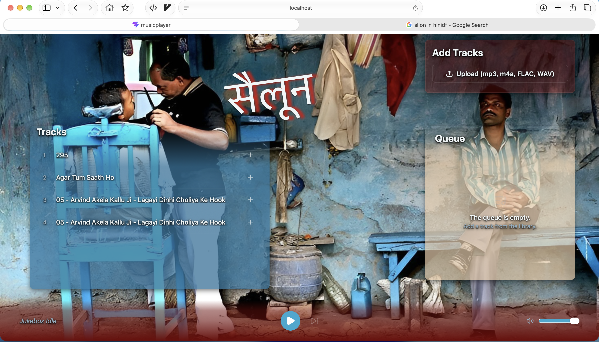

# Jukebox for Saloon
- A simpel indian theme music player built with React and TypeScript
-  allows users to upload their own music files manage a library of tracks and play them in a queue.

image

# Features 
- Play from existing tracks or upload your own music files
- Create a queue of tracks to play in order
- Persistent queue across page reloads
- change volume and skip tracks
 ### And a bug "SALOON" but in Hindi (indian) language 

# Tech Stack

- React (Vite),TypeScript, Custom CSS, Lucide React
- Storage: IndexedDB 

# Running Locally
1. clone the repo
    ` git clone https://github.com/ashish757/musicPlayer.git`
2. Install dependencies
    `npm install`
3. Start the development server
    `npm run dev`   

### Theme is based on indian street saloon and music Player is designed to give a nostalgic feel of the old days when people used to listen to music in saloons.
### Also the Color scheme is based on the colors from the bg image

## Learning
- fist of all localstorage has limit of 5MB so had to store the music fiels in indexedDB.
- and not just that, the url for that stored file in indexedDB changes on every reload so to make the queue persistent i had to find the url by id on each reaload

